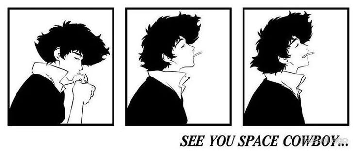

<i>"Whatever happens, happens."</i>

## Hey, I'm Havn

AI engineer (class of 2026) at **Nunnari Labs**, Coimbatore.

I'm the guy whose interests change every few months. Startups, edge AI, agents, open source, surfing. I&nbsp;go all in, then something new catches my eye.

Right now it's AI agents and reading other people's code, and honestly, I'm loving it.

I dream at 1M-user scale, then remind myself to just ship the small thing first.

### 🤠 Bounties on the board

- **[agent-lineup](https://github.com/HARSHAVARDHAN-RAJU5/agent-lineup)**: tells you what your coding agent changed after a run, and flags risky edits before you commit.
- **[Orchestara](https://github.com/HARSHAVARDHAN-RAJU5/ap-state-orchestara)**: invoice processing as a 14-stage state machine. LLMs are workers, not decision makers. Published at IJSART.
- **Edge AI @ Nunnari Labs**: getting segmentation models running fast on Qualcomm hardware for assistive navigation.
- **Open source**: built the MCP setup behind `memanto connect` (Claude Code, Codex, Cursor).

### 📜 Teardowns

- [How LiteLLM is moving to Rust, one route at a time](https://www.linkedin.com/posts/harshavardhan-r-_litellm-the-open-source-gateway-a-lot-of-share-7522016356255301632-pPm3/), Oct 2026

[LinkedIn](https://linkedin.com/in/harshavardhan-r-) · [Email](mailto:harshahv5rm@gmail.com)

See you around, cowboy.

